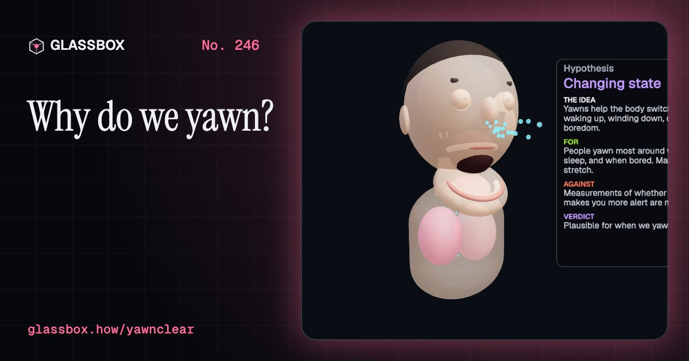
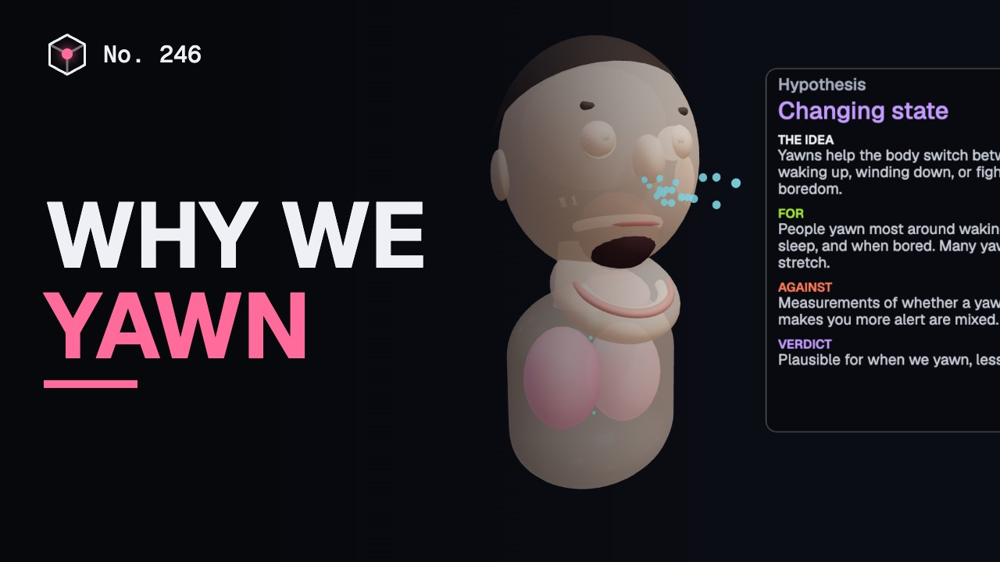
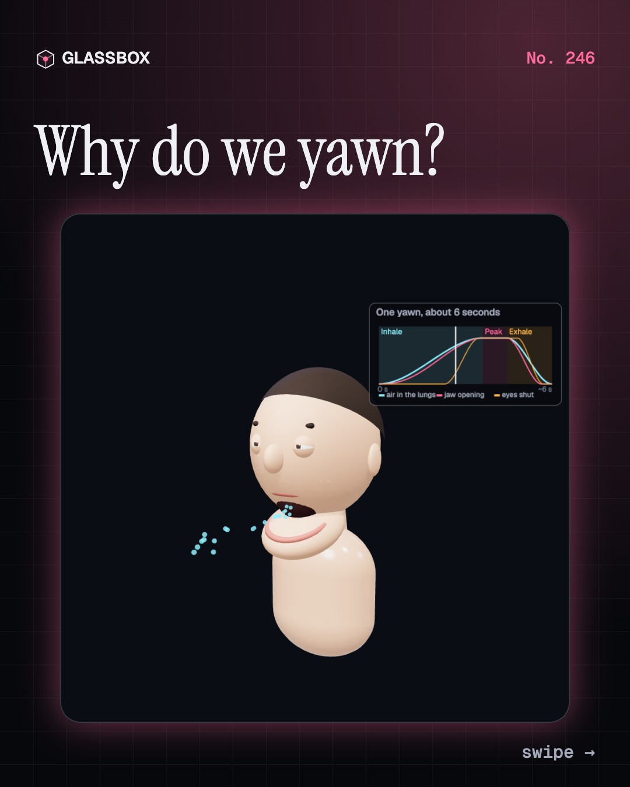
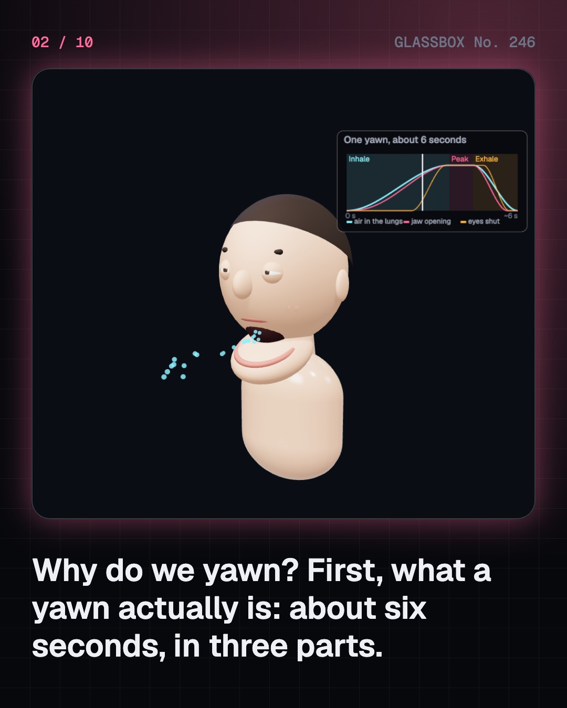
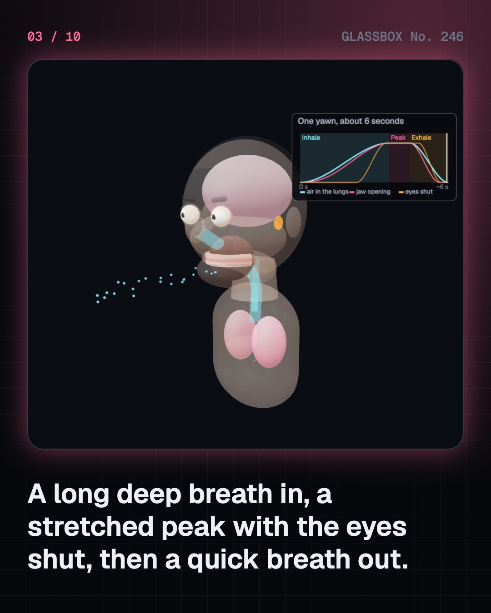
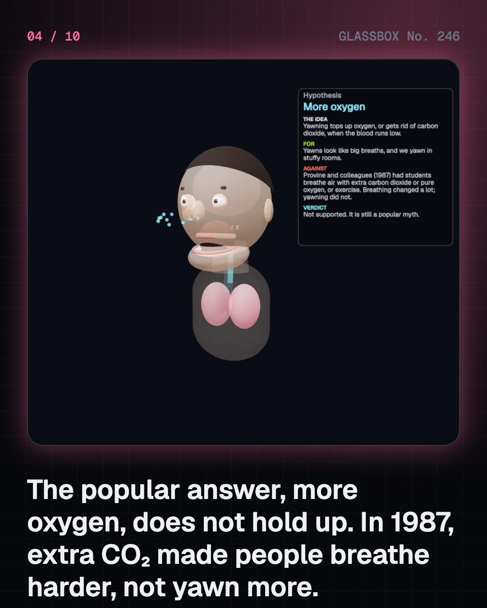

<!-- glassbox:start -->
<!-- Generated from glassbox.json by the Glassbox hub (npm run readme -- yawnclear). Edit glassbox.json, not this block. -->
<p align="center"><a href="https://glassbox.how/e/yawnclear/"></a></p>

<h1 align="center">YawnClear</h1>

<p align="center"><b>Why do we yawn?</b><br>You probably yawned before you were born, and reading this might make you yawn now. Scrub through one six-second yawn, test the oxygen myth, see the brain-cooling idea and its thermal window, and watch a yawn spread around a room.</p>

<p align="center"><a href="https://glassbox.how/yawnclear/"><b>▶ Play with it</b></a> &nbsp;·&nbsp; <a href="https://glassbox.how/e/yawnclear/">Read the 60-second explainer</a></p>

<p align="center">
  <a href="https://glassbox.how/e/yawnclear/"></a>
  <a href="https://glassbox.how/e/yawnclear/"></a>
  <a href="LICENSE"></a>
  <a href="LICENSE-CONTENT.md"></a>
  <a href="#privacy"></a>
</p>

## In 60 seconds

1. **A fixed six-second routine.** A yawn is a built-in sequence: the jaw drops wide with a long, deep breath in, a short peak where the face stretches and the eyes close, then a quicker breath out. A typical adult yawn lasts about 6 seconds, though single yawns vary.
2. **Not about oxygen.** The popular idea that we yawn for more oxygen has weak support. In 1987 Robert Provine and colleagues found that breathing air with extra carbon dioxide, or exercising, made people breathe harder but not yawn more, and pure oxygen did not stop yawns.
3. **Maybe a brain cooler.** A leading hypothesis (Gallup and Gallup, 2007) is that yawning helps cool the brain by boosting blood flow and drawing in air. It predicts a thermal window: most yawning when the air is mild, less when it is freezing or as hot as the body. It is still debated.
4. **Switching gears.** We yawn most around waking, before sleep and when bored. One idea is that yawns help shift the body between states of alertness. No single explanation is settled, and yawning may do more than one job.
5. **Catching yawns.** Seeing, hearing or even reading about a yawn can trigger one. Roughly 40 to 60 percent of adults catch yawns in lab studies, and yawns spread most between family and friends. Its link with empathy is debated.
6. **Old and widespread.** Fish, reptiles, birds and mammals have been seen to yawn, and dogs can catch yawns from people. Across mammals, species with bigger brains tend to yawn for longer. Humans yawn in the womb from about 11 to 12 weeks, but only start catching yawns at around 4 or 5.

## Words worth knowing

| Term | Meaning |
|---|---|
| **Yawn** | An involuntary wide opening of the mouth with a long, deep breath in, a brief peak and a shorter breath out. |
| **Fixed action pattern** | A built-in sequence of movements that, once started, usually runs to the end. |
| **Hypothesis** | A proposed explanation that can be tested and could turn out wrong. |
| **Brain-cooling hypothesis** | The idea that yawning helps keep the brain at its best working temperature. |
| **Thermal window** | The prediction that yawning is most common at moderate air temperatures. |
| **Contagious yawning** | Yawning set off by seeing, hearing, reading or thinking about someone else yawning. |
| **Spontaneous yawning** | Yawning with no outside trigger, for example when tired or bored. |
| **Familiarity bias** | Yawns spread more easily between people, or animals, who know each other well. |
| **Eustachian tube** | The tube linking the middle ear to the throat, which a yawn can open, making the ears pop. |

## A short history

**From a Greek theory of trapped air to yawning lions and budgies: how people figured out why we yawn.**

- **1958** · X-rays show the throat opening wide (Jacques Barbizet, France)
- **1982** · Ultrasound catches yawns before birth (J. I. P. de Vries, G. H. A. Visser and H. F. R. Prechtl)
- **1986** · A stopwatch study of the yawn (Robert Provine, University of Maryland, Baltimore County, USA)
- **1987** · Gas tests sink the oxygen myth (Robert Provine, B. C. Tate and L. Geldmacher, University of Maryland, Baltimore County, USA)
- **2004** · Chimpanzees catch yawns from video (James R. Anderson, Masako Myowa-Yamakoshi and Tetsuro Matsuzawa, University of Stirling (Scotland), University of Shiga Prefecture and Kyoto University (Japan))
- **2007** · The brain-cooling idea is tested (Andrew C. Gallup and Gordon G. Gallup Jr., University at Albany, New York, USA)
- **2011** · People yawn less in hot Arizona summers (Andrew C. Gallup and Omar T. Eldakar, Tucson, Arizona, USA)
- **2016** · Bigger brains, longer yawns (Andrew C. Gallup, A. M. Church and A. J. Pelegrino, SUNY Oneonta, New York, USA)

The full story, with 44 moments, charts, people and 41 sources: [glassbox.how/e/yawnclear/history](https://glassbox.how/e/yawnclear/history/). The data lives in [`history.json`](history.json).

## Video and slides

Made with the Glassbox studio from this box's storyboard (`window.glassbox.director`). Free to reuse under CC BY 4.0.

<a href="https://glassbox.how/yawnclear/glassbox/video.mp4"></a>

<p><a href="glassbox/slide-1.jpg"></a> <a href="glassbox/slide-2.jpg"></a> <a href="glassbox/slide-3.jpg"></a> <a href="glassbox/slide-4.jpg"></a></p>

| File | What | Size |
|---|---|---|
| `glassbox/slide-1…10.jpg` | Instagram carousel | 1080×1350 |
| `glassbox/thumb.jpg` | YouTube thumbnail | 1280×720 |
| `glassbox/cover.jpg` | Share card and repo social preview | 1200×630 |

## Privacy

This box has no accounts and no ads, and it ships its own fonts and libraries. When you run it yourself it sends nothing anywhere. On glassbox.how, the site's `/bar.js` also loads Glassbox's analytics: **Google Analytics** to count visits (it asks first in the EU, UK and Switzerland, and stays off when your browser sends Global Privacy Control or Do Not Track) and **ClickTrust** to detect bots.

It remembers a few things **in your own browser only**, and never sends them anywhere:

| Browser storage key | What it holds |
|---|---|
| `yawnclear.v1` | Which chapters you have opened, your best quiz scores, and sound on or off. |

Exactly what each one sees is at [glassbox.how/privacy](https://glassbox.how/privacy/).

## Licences

- **Code:** [MIT](LICENSE). Use it, change it, ship it.
- **Explanations, text, images and videos** (`glassbox.json`, `glassbox/`): [CC BY 4.0](LICENSE-CONTENT.md). Credit “Glassbox, glassbox.how/e/yawnclear”.
- **Third-party parts** keep their own licences: [three.js](https://threejs.org) (MIT), [Geist, Instrument Serif](https://openfontlicense.org) (SIL OFL 1.1), [Yawn durations and brain weights (species averages re-plotted in the animals chapter): Massen J.J.M. et al. (2021) Communications Biology 4:503, open dataset on DataverseNL (doi:10.34894/9HENTF)](https://dataverse.nl/dataset.xhtml?persistentId=doi:10.34894/9HENTF) (CC0 1.0).
- The Glassbox name and logo aren't covered by either licence. See the [terms](https://glassbox.how/terms/).

Found a mistake? [Open an issue](https://github.com/bdeeps/yawnclear/issues). Corrections happen in public.
<!-- glassbox:end -->

## Run it

It's plain HTML, CSS and JavaScript. No build step and no dependencies. Run locally, it contacts no other website.

```bash
python3 -m http.server 8000
```

Three.js and the fonts ship in `vendor/` and `fonts/`, so it also works offline.

Then open http://localhost:8000.

## How it's built

| File | What |
|---|---|
| `index.html`, `css/app.css` | The page and its styles |
| `js/app.js`, `js/stage.js`, `js/ui.js`, `js/kit.js` | The shared Glassbox 3D engine: chapters, 3D stage, controls, quiz, video director |
| `js/chapters/*.js` | One file per chapter: the 3D model, controls, text, key terms, quiz and video scenes |
| `glassbox.json` | Title, question, explainer beats, key terms, browser storage and credits shown on glassbox.how |
| `reel` in each chapter | The storyboard the Glassbox studio records into short videos |
| `glassbox/` | The published video, slides, thumbnail and post copy |
| `fonts/`, `vendor/three/` | Self-hosted Geist and Instrument Serif (SIL OFL 1.1) and three.js (MIT) |
